<div align="center">
  
  <p><code>Five coursework notebooks covering KNN, MLP, MNIST, LBPH and EfficientNet transfer learning</code></p>

  
  
  
  
  
  
  

  <a href="#-overview">Overview</a> · <a href="#-projects">Projects</a> · <a href="#-preview">Preview</a> · <a href="#-tech-stack">Tech Stack</a> · <a href="#-getting-started">Getting Started</a> · <a href="#-project-structure">Structure</a> · <a href="#-author">Author</a>
</div>


## ◈ Overview

An index of computer vision and pattern recognition notebooks written for coursework. They run from distance-based learning and hand-built neural networks to a classical face recognizer and a transfer learning model.

Each sub-project is one notebook with its own README. They are learning projects on small datasets, not production systems.


## ◈ Projects

<table>
<tr>
<td width="50%" valign="top">

**KNN Image Classification**

Manual K-Nearest Neighbors with L1 and L2 distance and cross-validation on grayscale, flattened images.

Recorded result: L1 best at k=1 with 33.33% accuracy, L2 best at k=9 with 41.00%.

[Folder](knn-multiclass-image-classification) · [Notebook](knn-multiclass-image-classification/knn_multiclass_image_classification.ipynb)

</td>
<td width="50%" valign="top">

**MLP Pattern Recognition**

A multilayer perceptron trained with backpropagation on numerical data, with decision boundary plots.

Recorded result: 0.99 test accuracy on 200 samples across 5 classes.

[Folder](mlp-pattern-recognition) · [Notebook](mlp-pattern-recognition/mlp_pattern_recognition.ipynb)

</td>
</tr>
<tr>
<td width="50%" valign="top">

**MNIST Digit Recognition**

A fully connected Keras network (no convolutions) on flattened 28x28 digits.

Recorded result: 97.66% test accuracy after 5 epochs.

[Folder](neural-network-mnist-digit-recognition) · [Notebook](neural-network-mnist-digit-recognition/neural_network_mnist_digit_recognition.ipynb)

</td>
<td width="50%" valign="top">

**LBPH Face Recognition**

Classical OpenCV pipeline: Haar cascade face detection and an LBPH recognizer trained per identity.

Not deep learning. Datasets are not included.

[Folder](lbph-face-recognition) · [Notebook](lbph-face-recognition/lbph_face_recognition.ipynb)

</td>
</tr>
<tr>
<td colspan="2" valign="top">

**EfficientNet Face Recognition**

Transfer learning with a frozen EfficientNetB0 base, augmentation and a small dense head, plus a webcam loop that marks low-confidence faces as Unknown. It was trained on a very small private set (66 face crops), so its validation score says little about real-world accuracy. Datasets are not included.

[Folder](efficientnet-face-recognition) · [Notebook](efficientnet-face-recognition/efficientnet_face_recognition.ipynb)

</td>
</tr>
</table>


## ◈ Preview

<div align="center">
  
</div>


## ◈ Tech Stack

| Layer | Technologies | Purpose |
|---|---|---|
| Language | Python | Notebook code |
| Vision | OpenCV, Pillow | Face detection, LBPH and image loading |
| Deep learning | TensorFlow, Keras | MNIST network and EfficientNetB0 transfer learning |
| Classical ML | NumPy, scikit-learn | KNN, MLP and evaluation reports |
| Environment | Jupyter, Google Colab | Running the notebooks |


## ◈ Getting Started

```bash
git clone https://github.com/Saji-d/computer-vision-and-pattern-recognition.git
cd computer-vision-and-pattern-recognition
pip install jupyter numpy matplotlib opencv-contrib-python scikit-learn tensorflow pandas pillow tqdm
jupyter notebook
```

The face recognition notebooks read a local folder of images arranged as one sub-folder per person. The paths in them point to the author's machine, so edit `dataset_path` before running. Face datasets are private and are not included. The webcam cells need a connected camera and LBPH needs `opencv-contrib-python` for `cv2.face`.


## ◈ Project Structure

Five notebook folders, each with its own README, plus `assets/` and `docs/` for the banner and preview.

```text
computer-vision-and-pattern-recognition/
├── efficientnet-face-recognition/
├── knn-multiclass-image-classification/
├── lbph-face-recognition/
├── mlp-pattern-recognition/
├── neural-network-mnist-digit-recognition/
│   (each folder holds one notebook and a README)
├── assets/      banner and divider
├── docs/        preview image
└── LICENSE
```


## ◈ Author

**Sajidur Rahman Sajid**: Full-Stack Developer and AI engineer from Dhaka.<br>
BSc in CSE at American International University-Bangladesh (AIUB).

<p>
  <a href="https://www.sajidur.me"></a>
  <a href="https://www.linkedin.com/in/sajidur-rahman-sajid/"></a>
  <a href="https://github.com/Saji-d"></a>
  <a href="mailto:sajidsajidurrahman99@gmail.com"></a>
</p>

<sub>Released under the MIT licence.</sub>
